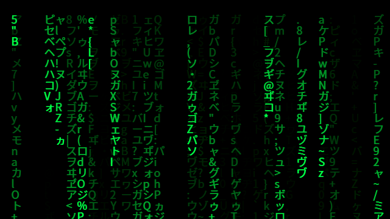

# x11saver

[](https://github.com/drsjb80/x11saver/actions/workflows/tests.yml)

A small, plugin-based screensaver for X11 desktops. It runs a fullscreen
pygame window with an effect, and on the first key press or mouse click it
locks the session and exits.

This isn't a traditional lock/screensaver, and works a little differently from
one. It behaves almost the same, but you have to turn off the system lock
screen yourself (see [Daemon mode](#daemon-mode)), since otherwise the built-in
one may start and lock first. It also doesn't restart once the lock or login
screen is showing: while the session is locked, the saver stays stopped and
starts again only after you unlock and go idle.

## Install

To install just the program into `~/bin` (`x11saver` plus the `plugins/`
directory, nothing else):

```
mkdir -p ~/bin
curl -L https://github.com/drsjb80/x11saver/archive/refs/heads/main.tar.gz \
    | tar xz -C ~/bin --strip-components=1
```

Run the same command again to update. It overwrites the existing files.

It also needs pygame and python-xlib. Install them with your package manager
(`sudo apt install python3-pygame python3-xlib` on Debian/Ubuntu/Mint), or with
`pip install pygame python-xlib`.

On most distros `~/.profile` adds `~/bin` to `PATH` if it exists when you log
in. If you just created it, log out and back in, or run `~/bin/x11saver`
directly.

To work on x11saver itself, clone the repository instead. The download leaves
out the tests, tools and docs.

## Usage

```
./x11saver thematrix
./x11saver starfield
```

The plugin name can also be given as a path, e.g. `plugins/thematrix`.

Requires Python 3 and pygame (`pip install -r requirements.txt`).

## Plugins

### thematrix

Green characters falling in columns, mixing ASCII and katakana. If no
installed font can draw katakana, it uses ASCII only.



### starfield

Flying forward through a field of stars.


### rain

Slanted rain in a slowly shifting wind. Nearer drops are longer, brighter and
faster, and throw small splashes when they land.


### snow

Soft flakes sway and drift as they fall. Nearer flakes pile up into rolling
drifts, which hold for a while, melt away, and then build again in a new shape.


### Writing a plugin

A plugin is a module in `plugins/` that defines:

- `init(screen, size)`: called once after the display is set up
- `render(screen, dt)`: called every frame; `dt` is seconds since the last frame
- `shutdown()`: called once before exit

Optionally, a plugin can set a module-level `FPS` (default 30).

To add an effect, drop a new file in `plugins/` following that interface.

### Demo GIFs

`tools/capture` renders a plugin off-screen (no window needed) and saves a
looping GIF. It requires `ffmpeg`.

```
tools/capture rain                          # writes rain.gif
tools/capture snow --warmup 200 -o snow.gif # simulate 200s first so drifts form
tools/capture --demos                       # regenerate all GIFs in docs/demos/
```

When you add a plugin, add an entry for it to `DEMOS` in `tools/capture` so
`--demos` includes it.

## Locking

On exit the runner locks the session before closing its window, so the
desktop never shows through. It picks a lock command from
`XDG_CURRENT_DESKTOP`:

| Desktop | Command |
|---|---|
| Cinnamon | `cinnamon-screensaver-command --lock` |
| MATE | `mate-screensaver-command --lock` |
| Xfce | `xflock4` |
| GNOME, KDE | `loginctl lock-session` |

If no command works, it falls back to `loginctl lock-session`. If that also
fails, it prints a warning and exits without locking.

Only Cinnamon has been tested so far.

## Input handling

Input is ignored for the first second so startup events don't close the
screensaver immediately. After that, a key press or mouse click exits.

Mouse motion exits too, by default on any movement. To tolerate small jitter,
pass a threshold in pixels; motion only exits once the pointer has moved more
than that far from where it was when the grace period ended:

```
./x11saver thematrix --mouse-threshold 10
```

## Daemon mode

`-d` runs x11saver in the background. It checks the X server's idle time once
a minute, and when you've been idle for 10 minutes it starts the saver. When
the saver exits (on input, after locking), the daemon keeps watching.

```
./x11saver -d thematrix
./x11saver -d starfield --timeout 5 --interval 30
```

- `--timeout MINUTES` sets the idle time before the saver starts (default 10).
- `--interval SECONDS` sets how often idle time is checked (default 60).

Stop the daemon with Ctrl-C, or `pkill -f "x11saver -d"`.

Requires `python-xlib` (`pip install -r requirements.txt` installs it).

Set the built-in screensaver's idle timeout to "never". Otherwise both will
try to start, and the built-in one may lock the screen first.

To start it at login, add the command to `~/.profile` and put `&` at the end so
it runs in the background. If your profile runs before the X session starts,
the daemon will print a warning each check until the display is available.

## Testing

The tests run headless (no display needed), using SDL's dummy video driver.
Set up a virtual environment once; `--system-site-packages` lets it reuse a
distro-installed pygame and python-xlib:

```
python3 -m venv --system-site-packages .venv
.venv/bin/pip install -r requirements-dev.txt
```

Then run the tests with a coverage report:

```
.venv/bin/python -m pytest --cov
```

The plugin smoke tests pick up every file in `plugins/` automatically, so a
new plugin is checked at several screen sizes without writing anything. A test
also fails if a plugin is missing from `DEMOS` in `tools/capture`. The capture
tests that encode GIFs are skipped when `ffmpeg` isn't installed.

## License

MIT. See [LICENSE](LICENSE). The same notice is at the top of `x11saver`, so
the download-only install carries it too.
